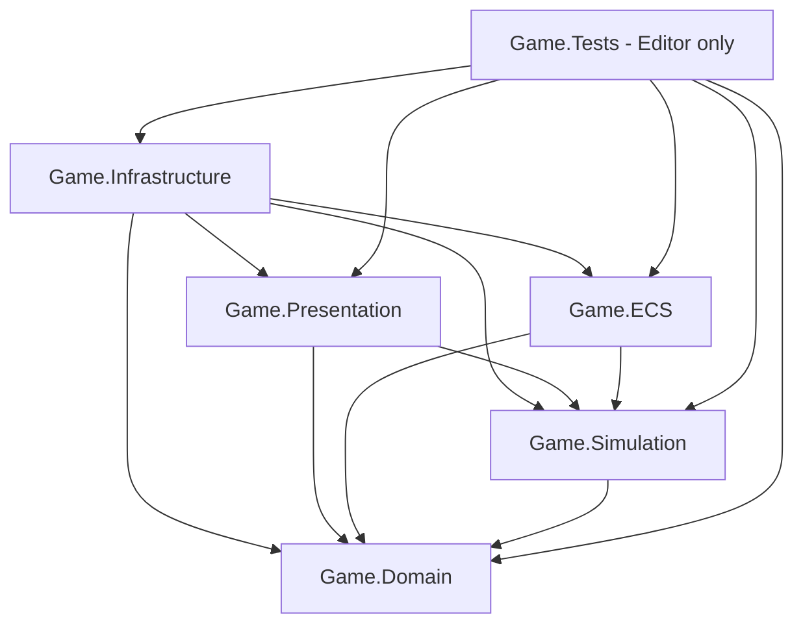

# Architecture — U01

## Scope and source
Implemented in U01: five runtime assembly boundaries and Game.Tests (EditMode), dependency checks, and this architecture contract. Runtime files contain assembly metadata only; services below are ownership contracts for later tasks, not implemented gameplay. FRS_Unity.docx sections 4, 33, 39–40 and 42.2–42.7 guide the design. D-008 overrides the original Editor target with Unity 6000.6.4f1.

## Compile-time dependencies
An arrow means a direct assembly reference. All runtime assemblies live under Assets/Game/<layer> and use the matching Game.<layer> namespace.

| Assembly | Direct project references | Ownership |
|---|---|---|
| Game.Domain | None | Stable IDs, canonical serializable world/person/cohort models, invariants, pure rules and definition values (U04 onward). |
| Game.Simulation | Domain | Clock/calendar (U03), centralized tick scheduling, use cases, commands/queries, RNG streams, tier transitions and aggregate simulation. Defines ports consumed by orchestration. |
| Game.ECS | Domain, Simulation | Tier2 components/jobs/systems and adapter implementing the Simulation tier execution port. Maps stable IDs to transient Entity handles. DOTS implementation starts U12. |
| Game.Presentation | Domain, Simulation | Tier1 views, cameras/input, UI, animation/audio/VFX; converts input into commands and renders snapshots/events. No ownership of persistent state. |
| Game.Infrastructure | Domain, Simulation, ECS, Presentation | Application composition root, save codecs/storage/migrations, configuration and content loading, scene loading and adapter wiring. |
| Game.Tests | All five runtime assemblies | Editor-only architecture checks now; pure unit and adapter tests as features arrive. |

Domain and Simulation set noEngineReferences=true; both are pure C# with no Unity types in their public contracts. Other runtime layers permit Unity API. All five set autoReferenced=false, so predefined assemblies cannot silently couple to them. Explicit assembly references are required for future clients. Unsafe code is disabled. No runtime assembly references tests or UnityEditor.

Infrastructure is deliberately the outermost composition layer: it may construct views and ECS adapters, while neither references Infrastructure. Persistence/configuration ports belong to Simulation, using Domain values. Infrastructure implements those ports and injects them when starting a session. This avoids a sixth runtime bootstrap assembly or dependency cycles. Editor authoring extensions will need a separate Editor-only assembly when introduced.

U02 installs and pins the FRS package profile (see PACKAGES.md). Game.ECS remains a compiled boundary with metadata only; U12 will add required explicit ECS package references. No runtime dependency edge changes in U02. Changing any edge requires updating this document and its architecture checks.

## State ownership and execution flow
The session owns the canonical Domain state across scene loads. Simulation controls writes and tick order; Presentation receives read models and submits commands, never modifies state through views. Definition assets are authored as ScriptableObjects in Infrastructure and converted into validated immutable Domain values at session creation. They are not mutable save-state.

Planned flow: input -> Simulation command queue -> validate Domain rules -> scheduled simulation step -> commit state -> publish read model/events -> views. A single session driver advances scheduled systems; mass NPCs do not each receive an Update loop. Pause halts advancement while commands remain queueable.

U03 implements the central time foundation. `GameTimeState` is canonical Domain state with separate integer calendar and biological ticks plus selected speed and pause. `GameClock` is a pure Simulation service that accepts an explicit real-time delta; it never reads Unity wall/frame time or changes `Time.timeScale`. This same API can be driven once per session by Tier 1 presentation, by batched Tier 2/DOTS scheduling, or by Tier 3/offline aggregate simulation. Calendar conversion uses a fixed 365-day year for current rules. Biological acceleration is independently configurable and defaults to 400x calendar time; character life stages and pregnancy timers remain future domain features.

Tier2 ECS data is a working projection during a scheduled step, not a second independently writable source of truth. Simulation supplies inputs; the ECS adapter completes jobs and returns validated deltas at a synchronization barrier. Only after committing those deltas can saves or tier transitions run. StableEntityId-to-Entity and StableEntityId-to-view maps are transient and rebuilt. Unity instance IDs and Entity indices never appear in persistent references.

Tier1 views may be pooled or destroyed without deleting their Domain records. Tier3 stores cohorts and aggregate state without per-person GameObjects or mandatory ECS entities. Persistent named characters keep individual records and IDs across all tiers. Transition orchestration flushes pending deltas, captures state, releases the old projection, and constructs the new one. Counts/resources must not be represented twice. Failed reconstruction must leave canonical state recoverable. These behaviors require integration tests in U13.

Off-camera snapshots preserve composition, health, supply/inventory, morale, orders, production, timers and RNG state. Outcomes advance from recorded seed/state and stable tick order; camera changes request representation changes and never reroll outcomes (U14).

## Persistence boundary
Simulation coordinates a consistent checkpoint after all pending commands/jobs for that tick are committed. Infrastructure serializes explicit versioned SaveData DTOs representing Domain state plus clocks, RNG and relevant scheduler/timer state. Scene objects, ScriptableObject instances and ECS handles are excluded; content references use stable definition keys. Loading validates schema/content, migrates supported versions and constructs a new session before attaching projections. Serialization format, ID encoding and migration implementation belong to U04; U01 does not choose them prematurely.

## Scene and lifetime strategy
The existing SampleScene remains the sole build scene in U01. No gameplay bootstrap is installed yet. The planned Infrastructure composition root will own one persistent session and the Simulation driver. A small bootstrap scene will create that root once; Local and Global content scenes will load/unload additively around it (U05/U25). Views register/unregister on scene lifetime and never own the session. Before unloading a scene, complete the simulation barrier and commit projections; then dispose subscriptions/jobs and release scene views. Returning binds views to retained state. A new game/load explicitly replaces the session, avoiding duplicate roots and stale static state. Third-person and RTS input will share Simulation commands and combat rules.

## Testing and validation
U01 Game.Tests uses the Unity compilation graph to verify that every runtime boundary participates in Player compilation, its DLL exists, exact approved project references are used, pure layers have no UnityEngine or UnityEditor dependencies, and Game.Tests is excluded from the Player graph. It also checks project asmdefs for cycles and explicit references. Existing U00 environment tests remain in their own Editor-only assembly and continue checking Editor, URP and scenes.

Pure rule and U03 time tests live in Game.Tests; save/load tests assert state equality including IDs, clocks and RNG. Introduce Game.Tests.PlayMode as a separate test assembly when scene/ECS integration exists; it must remain excluded from normal player builds. Tier transitions, pooling/lifetime and local/global changes need integration coverage. Performance gates and long soak tests belong to U29/U30, not U01.

Run Tools/Verify-U01.ps1 for all current EditMode tests and a Windows x64 Mono Development build using the existing U00Build entry point. This validates assembly boundaries, not gameplay, rendering quality or DOTS functionality. Exact results are recorded in docs/U01_HANDOFF.md.

## U04 implemented persistence
`Game.Domain.StableEntityId` provides immutable GUID identity and canonical N-format encoding; domain owners assign it once and future projections retain that ID. `SaveSnapshot` is immutable data-only version 1: SessionId, CalendarTicks, BiologicalTicks, SpeedMultiplier, IsPaused and BiologicalMultiplier. It creates detached U03 `GameTimeState` instances; no Character Domain or tier implementation is introduced.

`Game.Simulation.ISaveStore` saves/loads snapshots by a separate slot ID. `SaveCoordinator` captures time and settings at a caller-established simulation barrier and validates them through U03 GameClock. Load validates and constructs a replacement clock/settings before replacing its active Clock and SessionId. Consumers must rebind after a successful load; old clock references are detached. Calls are synchronous and owner-thread-only, with no jobs running or ticking concurrently. No Unity APIs or extra assembly edges were introduced.

`Game.Infrastructure.SaveXmlCodec` writes strict version-1 XML using framework XML APIs. Required fields, scalar types, stable IDs, bounds and supported speeds are validated; DTDs are prohibited and version-1 documents are limited to 64 KiB. Unknown versions are rejected explicitly, not migrated. `FileSaveStore` owns codec/storage, validates before writing, flushes a unique same-directory temporary file and atomically replaces/renames it. Failed operations leave the last committed slot available; temporary cleanup is best effort. Missing files and I/O failures remain explicit .NET exceptions. This local adapter exercises the provider boundary that U04A can implement independently.

Run Tools/Verify-U04.ps1 for the full EditMode suite and Windows Development build. See U04_HANDOFF.md for results and limitations.

## U07 Tier 1 character presentation
The Tier 1 flow is `Character -> CharacterPresentationCatalog -> CharacterPresentationSpawner -> CharacterPresenter`. The first object remains canonical Domain state; the latter three belong to Presentation and contain only replaceable configuration or ephemeral runtime bindings. The catalog currently maps biological sex deterministically to the U05A male/female wrappers. It is the replacement seam for future appearance descriptors and final Stone Age art, so prefab, Animator, renderer, Transform and sockets never enter Domain or persistence.

`CharacterPresentationRegistry` is an ordinary session-owned `StableEntityId -> CharacterPresenter` map. It rejects duplicate active views, unregisters only the matching view, and is distinct from the canonical `CharacterRegistry`. `Bind`/`Unbind`, destruction and respawn retain the same aggregate and stable ID. The spawner accepts an existing `Character` plus a presentation transform and never creates a domain person.

The wrappers contain the root presenter and capsule collider, a nested source visual with valid Humanoid Animator/Avatar, and left/right hand sockets parented to humanoid bones. The project-owned controller defaults to Idle and provides `Speed`/`Moving` foundations for idle/walk/run. Presentation refresh is explicit; there is no per-presenter `Update`, GameClock dependency, simulation movement, navigation or AI. Presentation pause sets Animator speed locally and does not use `Time.timeScale`.

`LocalSceneCompositionRoot` constructs a demo `CharacterRegistry`, presentation registry and spawner, then creates one male and one female through `Character.CreateNew`. This is development composition, not world population or persistence. `SelectionProbe` may retain a selected presenter/ID as disposable control state; raycast selection never owns or deletes the aggregate. Assembly arrows remain unchanged: Presentation already depends on Domain, and Domain remains engine-free.

## U04A PostgreSQL persistence
`Game.Infrastructure.Persistence.Postgres` implements the unchanged synchronous `ISaveStore` port. `PostgresSaveStore` accepts and returns only `StableEntityId` and `SaveSnapshot`; it has no scene, GameObject, ECS, presentation or clock references. Domain and Simulation do not reference Npgsql. Runtime state remains authoritative in RAM, and the caller invokes storage only after the same committed simulation barrier required by U04.

Npgsql 8.0.9 is explicitly referenced by Infrastructure and Editor tests. A process-environment configuration object accepts only loopback endpoints and constructs the connection internally. It never exposes the connection string. Calls open and close their own unpooled connection, use finite timeouts and wrap provider failures in a redacted operation/SQLSTATE exception. Missing slots and corrupt/unsupported content retain U04 exception semantics.

Database schema `serenity` is advanced by repository SQL scripts in one locked transaction. `schema_migrations` records the ordered version, filename, normalized-SQL SHA256 and application timestamp. Existing entries must match exactly. Initial migration 001 creates `save_sessions`: slot/session UUIDs, save-format version, binary XML payload and persistence timestamps. Slot UPSERT is one atomic parameterized statement. Load checks relational metadata against the decoded XML before exposing the detached snapshot. Database migration versions and snapshot format versions are deliberately separate.

The current relational schema is intentionally narrow. Future normalized history repositories receive their own Simulation ports and migrations; they must not turn PostgreSQL into a realtime simulation engine. Character/Dynasty/City/HistoricalEvent identity uses the same StableEntityId-to-UUID mapping. `GameClock` replacement/rebinding remains a composition responsibility after successful `SaveCoordinator.Load`.

## U05 local scene and control flow
`LocalGameplay` is the first interactive content scene and the enabled build scene. Its project-owned placeholder ground and markers deliberately avoid all staged/vendor content. `LocalSceneCompositionRoot` belongs to Infrastructure and holds explicit serialized references to the Presentation input source, camera controller, pointer raycaster and selection probe. Components do not discover each other through `FindObjectOfType`, a static registry or a service locator.

The U05 flow is `InputActionAsset -> LocalGameplayInputSource -> navigation/interaction intent -> RtsCameraController or SelectionProbe`. Raw physical bindings remain in the Input System asset. The camera controller consumes only the input interface and serialized settings; Cinemachine is used at the camera presentation edge rather than as the input/gameplay owner. Presentation adds direct package references to `Unity.InputSystem` and `Unity.Cinemachine`; project-layer arrows remain unchanged.

The RTS rig owns horizontal target position and yaw. It combines keyboard, normalized screen-edge and middle-drag movement, applies configurable rectangular bounds, and moves the fixed-pitch Cinemachine mount within min/max zoom. All navigation uses unscaled frame time and is independent of Simulation `GameClock`, `Time.timeScale`, persistence and stable identity. The controller is one ordinary presentation `Update`, not an NPC-scale update pattern.

`WorldPointerRaycaster` translates screen coordinates into physics hits/points through an explicitly assigned output Camera and layer mask. It contains the UI-block boundary through EventSystem without requiring UI infrastructure in U05. `SelectionProbe` listens to primary-click intent and highlights `SelectableMarker`; it neither creates a canonical selected-character model nor submits future orders. U20/U22 may reuse the pointer/input boundaries but must share Simulation commands and combat rules rather than place those rules in callbacks.

## U05A asset source and runtime boundary
The asset flow is `ignored external staging -> explicitly selected third-party source -> Serenity-owned runtime wrapper -> future presentation component`. Each arrow is deliberate and traceable in `docs/ASSET_REGISTRY.md`. Staging is never a Unity asset root. Unknown-license files remain quarantined, and already imported vendor folders are neither relocated nor automatically approved.

Third-party source lives either in its existing vendor path or, for selected staging files, under `Assets/Game/Art/ThirdParty/<publisher>/<package>`. Gameplay-facing prefabs and Serenity URP material variants live under `Assets/Game/Art`. Wrappers own normalized placement roots, simple readiness colliders and project-side animation controllers where needed. They do not own canonical character/animal/building state. Future Presentation code binds Domain read models to wrappers; Domain and Simulation never reference meshes, prefabs, Animators, scenes or vendor GUIDs.

`U05AAssetFoundation` is an Editor-only, manually invoked allow-list. It configures only seven registered FBX imports, builds deterministic project-owned wrappers and regenerates the development gallery. There is no catch-all import hook. Existing Hodaart import settings stay vendor-owned; their wrappers apply a measured 1.8 m presentation scale. Staging-derived scale belongs to the selected ModelImporter. Root wrappers resolve ground and attachment pivots without rewriting mesh data.

`StoneAgeAssetGallery` validates source compatibility and is absent from Build Settings. `LocalGameplay` remains the sole player scene and has no dependency on the gallery or vendor content. Addressables were not introduced because U05A has no runtime loading requirement. The asset tests gate prefab loads, renderers/materials, missing scripts, Avatar/animation readiness, importer scope, registry coverage and build-scene isolation; visual style judgment remains a recorded manual GPU-rendered inspection.

## U06 character domain
`Game.Domain.Characters.Character` is the canonical persistent-person aggregate. It is a sealed pure C# type in the existing no-engine `Game.Domain` assembly; it has no `MonoBehaviour`, `GameObject`, prefab, Animator, ECS Entity, ScriptableObject, Npgsql or SQL reference. `CreateNew` is the only path that generates a new `StableEntityId`; `Restore(CharacterState)` validates and retains an existing one. All mutable operations leave identity unchanged.

`CharacterState` is a detached immutable snapshot boundary. It contains identity, validated name and biological sex, biological birth/lifecycle ticks, parent links, current spouse, optional family/dynasty/profession references, traits, skills, inherited-foundation attributes, six-part health, Wealth, Influence and relationship scores. Capture orders ID/key collections deterministically. It is ready for an explicit future save DTO/codec, but U06 does not silently change the U04 `SaveSnapshot` version-1 wire format or PostgreSQL schema.

Age is derived from one canonical biological birth tick and the U03 biological timeline using fixed 365-day years. It never reads calendar ticks, Unity time, wall time or a private clock. Death records a biological tick and freezes age; mortality rules and aging scheduling remain future simulation work.

Parent links belong to the child and reference `StableEntityId`. Role and kind distinguish mother/father and biological/legal/adoptive parentage, including hidden biological parentage. Children are derived by `CharacterRegistry`, avoiding an independently mutable reverse list. The registry owns active-world uniqueness and symmetric current-spouse linking without becoming a global singleton or persistence repository. Missing/dead/off-tier relatives remain representable by stable IDs even when absent from the active registry.

Trait, skill and profession keys are compact validated definition IDs for later data-driven authoring conversion. U06 stores no ScriptableObject references. Health is only the FR-CHAR-005 body-part foundation; disease, wounds and medicine are deferred. Wealth/Influence store the documented 0–1000 personal values but U32 owns their formulas/effects. Needs, AI, pregnancy, genetics, succession, detailed relationships, inventory and presentation are intentionally outside U06.

`CharacterDomainTests` covers creation/restoration and immutable identity, name/sex/state validation, biological age boundaries and death, parent/spouse invariants, hidden versus legal father, deterministic state capture, trait/skill/relationship bounds and duplicates, body/attribute/social values, optional profession/family/dynasty hooks, registry uniqueness and derived children. Existing architecture tests continue to prove that Domain has no UnityEngine or UnityEditor reference.

## U08 building placement and presentation
The canonical flow is `BuildingDefinition -> BuildingPlacementService -> Building -> BuildingPresentationSpawner -> BuildingPresenter`. Definitions and placed aggregates are engine-free. A definition uses a validated content key; a placed aggregate uses its own `StableEntityId`. `BuildingState` captures coordinate, discrete orientation and planned/completed state without Unity types and can be restored with the same ID. This state is ready for a later world-save DTO, but U08 deliberately does not silently alter the U04 version-1 time snapshot or PostgreSQL migration.

`BuildingPlacementService` evaluates rectangular rotated footprints against `BuildingGridBounds` and `BuildingOccupancyGrid`. Occupancy is the deterministic authority; colliders are only presentation/raycast aids. Confirm evaluates again, generates a new identity, reserves the footprint and adds the aggregate to the session-owned `BuildingRegistry`. Duplicate stable IDs and occupied cells are rejected. Current coordinate data includes an explicit level so later floors/basements are not precluded, while U08 bounds permit only level zero.

`BuildingPresentationCatalog` is a ScriptableObject authoring adapter for the Primitive Shelter and Storage Basket placeholders. It produces pure definitions and maps definition IDs to Serenity-owned prefabs. `BuildingPresentationRegistry` maps stable building IDs to disposable presenters separately from canonical buildings. Spawner restore/respawn accepts an existing aggregate; it never creates Domain state. Preview clones are unbound, collider-disabled and tinted through MaterialPropertyBlock, so they have no ID, occupancy or save presence.

`BuildingPlacementController` is one scene-level Presentation update, not a per-building loop. It reuses `WorldPointerRaycaster`, including its UI-block boundary, and accepts only `BuildableGround` hits. One-metre grid size and origin are serialized configuration. B toggles placement, R rotates, left click confirms and right click/Escape cancels; the U05 Q/E camera binding is unchanged. `LocalInteractionMode` suppresses selection clicks during placement but never disables the unscaled RTS camera.

U08 confirm creates Planned state and immediately calls the explicit completion transition because resources and worker AI do not exist yet. U09 will supply real costs/inventories and U10/U11 can schedule workers without changing identity, occupancy or presentation ownership. Walls, doors, windows, rooms, roofs, multi-floor construction, damage/fire, free placement and edge/socket snapping remain deferred.

## U09 resources, inventories and storage
The canonical resource flow is `ResourceCatalog -> ResourceInventoryRegistry -> ResourceInventory`, orchestrated by Simulation services. Resource definitions, IDs, integer quantities, owners, detached inventory states and world-pile coordinates are pure Domain data. `ResourceCatalogAsset` and building catalog cost entries are authoring adapters only. Presentation receives existing inventories and reads them; it never stores a second mutable quantity.

Every inventory is addressed by `InventoryOwner(kind, StableEntityId)`. Current kinds are WorldPile, Character and BuildingStorage. A `WorldResourcePile` owns stable identity, one resource ID, an integer grid coordinate and a reference to its canonical inventory owner. A building storage owner reuses the building's stable ID. Character inventories reuse character IDs. Capacity is total bulk units; an optional category allow-list is checked before mutation. Zero quantities are omitted from captured state.

`ResourceTransferService` performs all-or-nothing moves and treats source==destination as a validated no-op. `SettlementResourceView` derives totals from explicit building-storage inventories. `WorldPileService` and `StorageService` create the owner-specific capabilities without coupling them to GameObjects. Capture/restore copies quantities, capacity and filters and preserves owner IDs; world save DTO/version work remains a later explicit persistence migration.

`ConstructionFundingService` composes U08 placement with resources. It plans exact deductions across an ordered set of funding owners, confirms logical placement, attaches storage when configured, charges costs, creates presentation through a callback, and completes the aggregate. Its compensation path refunds every charge and releases storage, registry and occupancy. Affordability preview never reserves or consumes resources. This preserves the invariant that failed confirmation changes neither stock nor occupied cells.

LocalGameplay composition creates four finite `DEV_BOOTSTRAP_ONLY` physical pile projections and two character inventories. The Primitive Shelter and Storage Basket costs and basket capacity are data-driven `BALANCE_TBD` values in the existing building catalog. `ResourceDebugOverlay` is one development-only read model showing aggregate quantities; pile and building presenters expose canonical bindings only. No per-resource or per-inventory Update loop was introduced, and project assembly arrows remain unchanged.

## U10 centralized Tier 1 Utility AI
The U10 flow is `Tier1AiAgentState -> Tier1AiScheduler -> utility selection -> action execution -> ITier1MovementDriver/U09 services`. Agent state is pure Domain data keyed by the existing Character `StableEntityId`; it contains bounded Hunger/Energy, simulation position and observable action phase. The scheduler is a session-owned Simulation service with stable ordering, deterministic phase staggering and independent decision/need/action batch caps. It consumes U03 `GameTimeAdvance.CalendarDelta`; a zero delta makes pause a complete simulation no-op. `Tier1AiRuntimeDriver` is the only AI `MonoBehaviour.Update`, so adding Tier 1 agents does not add frame callbacks.

Utility selection is finite, normalized and deterministic. Idle is always available, Rest scores inverse Energy, and Haul combines Energy/Hunger with canonical work availability. Explicit priority and action-enum order break equal scores. A configurable switch margin retains valid actions, and carrying is non-interruptible. Execution objects own the short-lived state machine, while `Tier1AiAgentState` remains independent from Animator or NavMesh callbacks.

`HaulWorldQuery` reads U09 world-pile, inventory and building registries and selects nearest valid source and storage with stable-ID tie-breaks. `HaulClaimRegistry` reserves source quantity and destination capacity without changing ownership. Pickup and dropoff invoke only `ResourceTransferService`; cancellation and failure release claims, and resources already picked up remain in the character inventory. Task IDs are typed session-local counters, distinct from persistent entity IDs. U09 immediate construction funding remains unchanged.

Presentation implements `ITier1MovementDriver` through AI Navigation 2.0.12 `NavMeshAgent`. LocalGameplay constructs one runtime `NavMeshSurface` over the project-owned ground, registers movement bridges for the two U07 demo presenters and drives the existing `Speed`/`Moving` Animator parameters with root motion disabled. Presenter loss unregisters active movement and claims without deleting the Character aggregate. Dynamic NavMesh obstacles/rebakes, saved in-flight tasks, work groups, DOTS execution and production are intentionally deferred.

The U10 development inspection path is `WorldPointerRaycaster -> SelectionProbe -> bound presenter -> canonical registry/object -> ephemeral debug snapshot`. Pile, building-storage and character panels never own quantities or job state. The left resource overlay derives live per-location and conserved totals from every registered inventory and the data-driven resource catalog. These are development-only `OnGUI` read views; they add no production UI, simulation command or per-entity Update.

## U11 work groups and jobs
The U11 command flow is `SelectionProbe/work overlay -> WorkManager -> WorkOrder -> Tier1AiScheduler -> action execution -> movement/U09 transfers`. `WorkManager` is an ordinary session-owned Simulation service. `WorkGroupRegistry` and `WorkOrder` are engine-free Domain state; neither knows about presenters, NavMesh, input callbacks or `GameObject`. Group membership, commanders and targets reference existing stable IDs, while `WorkGroupId` and `JobId` prevent group, entity and order identities from being conflated.

A group is an ordered set of unique character IDs with an optional member commander. The registry enforces settlement-wide single-group membership. Group Move/Haul submissions expand in stable member order into individual work orders, skip ineligible or occupied workers and reserve exclusive targets where required. `IWorkEligibilityPolicy` is the extension seam for later profession, health, tier and jurisdiction constraints; its U11 implementation only verifies that the canonical character exists and is alive.

The job model has an explicit priority and lifecycle. Queued jobs may be assigned deterministically to eligible agents; assigned work becomes Active only when execution starts and ends in Completed, Cancelled or Failed. Cancellation/failure always releases the work target reservation and any U10 haul claim. Haul pickup/dropoff still uses the sole U09 `ResourceTransferService`, preserving physical logistics and inventory conservation. Orders and claims are session-ephemeral in U11, so the U04 save format and PostgreSQL migration remain unchanged.

`Tier1AiScheduler` remains the single Tier 1 scheduling authority. Its precedence is carrying, critical Energy rest, manual work, then autonomous utility. This permits player control without allowing direct input code to manipulate NavMesh agents or inventory. Both manual and autonomous hauling share `HaulActionExecution`; manual movement shares `ITier1MovementDriver`. One scene-level runtime driver advances all agents, and no work-group, job or character component adds an individual `Update`.

Presentation extends the existing U05 selection boundary with Shift additive/toggle selection and a disposable selected-ID list. The development-only work overlay issues commands, cycles priority and supports Ctrl+1…9 assignment plus 1…9 recall. `CharacterPresenter.IsSelected` is visual/ephemeral only. Group membership and job state remain valid when a presenter is destroyed and rebound to the same aggregate. Production selection and UI styling remain U27 work.

Development IMGUI is part of the U05 pointer boundary even though it is not represented by `EventSystem`. Each visible debug overlay registers its GUI-space blocking rectangle with `WorldPointerRaycaster`. A primary click is tested against those regions before physics or selection mutation; a blocked click is consumed, while a genuine unblocked world miss retains the existing clear-selection behavior. U11 work buttons dispatch from the same Input System primary-click event after that guard, so commands observe the current selection rather than a selection already cleared by click-through.

RTS manual movement extends the same boundary: `Pointer/SecondaryClick -> ManualMoveInputController -> WorldPointerRaycaster -> ManualMoveCommandService -> WorkManager -> Tier1AiScheduler -> ITier1MovementDriver`. The controller performs no physics query of its own beyond the one existing raycaster call and accepts only `BuildableGround`. The engine-free command service deterministically assigns centred formation slots and uses `ICharacterTierLookup` only to authorize current Tier 1 execution. Tier 2/Tier 3 targets return explicit unavailable entries; the command neither transitions tiers nor changes U14 continuity. The Presentation layer never calls `NavMeshAgent.SetDestination` directly.

## U12 Tier 2 DOTS bootstrap
The U12 flow is `Character/StableEntityId -> Tier2TransferState -> Tier2Materializer -> ECS components -> Tier2SimulationSystem -> Tier2TransferState extraction`. It lives entirely in `Game.ECS`, whose new package references are one-way to Entities, Burst, Collections and Mathematics. `Game.Domain` and `Game.Simulation` remain engine-free and expose only the existing character and `GameTimeAdvance` contracts.

`Tier2StableIdentity` stores the same canonical GUID identity as two unmanaged 64-bit values. `Tier2BiologicalState` projects only sex, birth tick, life state and optional death tick. `Tier2Position`, `Tier2Movement` and `Tier2SimulationProgress` hold the supported mutable simulation subset. The five components are unmanaged and total 92 bytes per entity before chunk/header overhead. They contain no strings, managed classes, Unity objects or GameObject references.

`Tier2Materializer` is the single U12 structural-change boundary. It prevalidates batch identities, rejects duplicates, creates one shared archetype in bulk and maintains a managed stable-ID-to-Entity index outside hot components. Extraction waits behind the runtime's completed-job barrier and returns the same ID plus every supported field. Entity handles are never persisted or exposed as identity.

`Tier2Runtime` owns a private explicit `World` and a single step singleton. Callers pass U03 `GameTimeAdvance`; the runtime writes its integer calendar/biological ticks, invokes `Tier2SimulationSystem` and completes tracked jobs before returning. The system schedules one parallel `[BurstCompile] IJobEntity` over the whole matching query. A zero/paused advance schedules zero entities and changes no state. No Tier 2 type derives from `MonoBehaviour`, and materializing 1,000 entities adds zero GameObjects.

Authority is field-scoped. The Domain character remains the durable authority for identity, biography, family, relationships, health and all state not represented in U12. During an active Tier 2 projection, ECS owns its projected position, movement and processed-step values until explicit extraction. U12 does not automatically dematerialize Tier 1, materialize Tier 2 from camera distance, write Tier 3 aggregates, update saves or register its world in Unity's default player loop. U13 owns those coordination and transition barriers.

## U13 tier manager and transition barriers
The U13 flow is `Character + active adapter -> CharacterRuntimeState capture -> target validation -> source release -> target materialization`. `TierManager` belongs to engine-free Simulation and knows only `ICharacterTierAdapter`; Presentation implements Tier 1, ECS implements Tier 2, and Simulation implements the pure-data Tier 3 adapter. Infrastructure constructs them for one session. This preserves the existing one-way assembly graph and avoids a singleton or an ECS/Unity dependency in Simulation.

`Character` stays alive and canonical across all tiers. Its durable biography, family, full health, traits, skills, profession and relationships are not duplicated in active representations. U09 inventory and U11 group/order registries continue to reference the same character ID. `CharacterRuntimeState` carries only mutable representation continuity: precise world position, lightweight movement/progress, a coarse location key and U10 needs needed for Tier 1 rematerialization.

Tier 1 capture reads the presenter position and centralized AI state. Dematerialization unregisters the AI/movement bridge before unbinding the presenter; this cancels the NavMesh-only execution, releases claims and requeues active manual work without removing its high-level assignment. Tier 1 materialization uses the existing deterministic sex catalog, so a round trip does not choose a new appearance. NavMesh paths are deliberately not transferred into Tier 2/Tier 3.

Tier 2 uses the U12 `Tier2TransferState` and materializer unchanged as its data path. `Tier2Runtime.Extract` and `Dematerialize` complete all tracked jobs before reading or destroying an entity. ECS remains authoritative only for projected position, movement and progress while active. Tier 3 uses one `Tier3CharacterRecord` per named person and no GameObject or ECS Entity; U14 will provide its deterministic advancement.

Transitions are transactional at the session coordination boundary. Target validation occurs while the source is still valid. After capture, the source is released and the target is committed; if target materialization throws, any partial target is removed and the source is rematerialized from the captured state. Tests cover forced failure rollback, every direct transition, same-tier no-ops and 100 repeated round trips with exactly one active representation.

`TierDistancePolicy` is an optional policy layer over the explicit transition API. It uses ordered hysteresis thresholds, deterministic stable-ID iteration, minimum residency evaluations, an evaluation budget and a transition budget. It may select direct Tier1↔Tier3 transitions but does not mutate simulation outcomes or advance off-camera state. `Tier1AiRuntimeDriver` remains the only scene AI `Update`; it publishes the already computed `GameTimeAdvance` so Infrastructure can step the private Tier 2 world and evaluate policy without advancing the clock twice.

## U14 deterministic off-camera simulation
The U14 flow is `explicit U03 time point -> OffCameraSimulationService -> stable-ID-ordered Tier3CharacterRecord batch -> committed CharacterRuntimeState -> U13 materialization barrier`. Core code remains in `Game.Simulation` with no UnityEngine, ECS, NavMesh, Animator, Npgsql or SQL dependency. `LocalSceneCompositionRoot` supplies the configured development world seed and current absolute U03 clock values; the existing single runtime driver offers a batch point before the distance policy evaluates transitions, while the Tier 3 adapter skips same-day frame calls in O(1) and traverses records at most once per fixed day.

One fixed step is one absolute calendar day. The record stores the exact last committed calendar and biological ticks, so sub-day remainder is implicit and snapshot-ready. Catch-up processes only crossed day boundaries; a one-year gap is 365 deterministic steps per character rather than a frame replay. Each step uses a counter-keyed sample from world seed, stable identity, absolute day index and an explicit stream ID. Stable-ID sorting is used for batch validation/hash output, while per-character samples are traversal-order independent.

U14 adds a deliberately generic `AbstractActivityProgress` plus deterministic accumulator as the first remote long-horizon stream. This is an audited deterministic seam for U15/U23/U28, not production, combat or events. It changes no canonical inventory, family, health, work-group or manual-order state. Tier 3 suspends Tier 1-only navigation/action execution and preserves Hunger/Energy; U15 may add remote production through canonical resource APIs, while U28 owns event effects and U18 owns disease/injury/mortality policy.

Promotion catches up and commits Tier 3 before Tier 1/Tier 2 materialization. Demotion validates the current absolute time and advances from the last carried checkpoint before the Tier 3 record becomes active. Tier 1 and Tier 2 keep U14 fields in the shared transition DTO, so a Tier3-only route and Tier3→Tier1/Tier2→Tier3 route converge under equal seed/time and no player intervention. Repeated targets are no-ops, backwards time is rejected, duplicate batch identities are rejected before commit and pause advances neither tick nor state.

`ComputeStateHash` hashes the configured seed and stable-ID-ordered U14 state only. It never includes Unity instance IDs, ECS entity indices, pointer values, timestamps or collection enumeration order. Constructor-level capture/restore plus continuous-versus-split tests provide the current save/restart boundary; U04 `SaveSnapshot` version 1 and PostgreSQL schema remain unchanged until an explicit durable world-save migration.

## U15 reusable production and farming

The U15 logical flow is `ProductionCatalog -> ProductionSite -> ProductionTask -> ProductionService -> U09 ResourceInventoryRegistry/ResourceTransferService`. Definitions and mutable progress are engine-independent; persistent sites and tasks use `StableEntityId`. Natural sites are finite and reserve one batch at a time. Recipes declare inputs, outputs, work duration and supported site kind, which is sufficient for future multi-stage crafting while the U15 catalog contains only berries, plant fiber, wood logs, stone and cultivated berries.

The production service owns target-stock decisions, site/worker claims, exact batch commits, crop growth, aggregate advancement, food consumption and deterministic state hashing. Resource quantities never exist in the overlay, presenter, ECS component or prefab. Output has one inventory owner, transitions through U09 exact transfers, and stays carried when storage is full. `FoodConsumptionService` removes available berries at its configured tick rate and records any unmet amount without driving hunger, death or health systems.

Tier 1 adds one Production utility/action path to the existing centralized scheduler: reserve -> move through `ITier1MovementDriver` -> work from simulation ticks -> commit once -> deliver through `ResourceTransferService`. Tier 2 adds only an unmanaged pending-work counter to its existing ECS projection and batch job; after the job barrier, stable IDs enter the same production authority. Tier 3 stable IDs enter that authority directly. One absolute-calendar-day fixed step, stable-ID/source sorting and representation-neutral hashes make collection ordering, catch-up chunking and Tier1/Tier2/Tier3 routes economically equivalent. No production entity owns an `Update`.

`primitive_crop_plot` is a normal U08/U09 placed and funded building whose stable ID activates a crop production site. Its deterministic lifecycle is Unplanted -> Growing -> Ready -> harvest -> Unplanted. Presentation is a disposable binding; current art reuses the Storage Basket prefab as a temporary placeholder.

`SaveSnapshot` version 2 embeds a detached `ProductionSaveState`: production time, food counters, targets, sites, active tasks, produced totals and canonical inventory states. Restore validates stable identities, recipe/site compatibility and claim uniqueness before replacing live registries. The strict codec still reads legacy version 1 saves and PostgreSQL continues to store the validated opaque payload with no schema change.

## U16 research framework and Stone Age progression

The U16 logical flow is `TechnologyCatalog -> ResearchService -> ResearchUnlockSet -> U08/U15 availability boundaries`. Definitions and save DTOs are in engine-free Domain; active progress and completion live in engine-free Simulation; Infrastructure composes the real building/production IDs; Presentation contains only a debug read/command overlay. Every persistent technology/worker reference uses a stable value ID.

The catalog has 14 Stone Age definitions and validates its graph and typed targets before play. `basic_survival` and `gathering` form starting knowledge. The remaining branches converge through shelter/woodworking/organized labor, fire/hunting/preservation, fiber/agriculture/weaving and advanced stonecraft into `stone_age_mastery`. Completing a technology rebuilds a derived unlock view; canonical building and recipe definitions stay in their original catalogs.

One settlement project accumulates integer work ticks. Each assigned worker stores its last absolute checkpoint and fixed-point rate remainder. Tier 1's central U10 scheduler owns the Research action, Tier 2 reports its active stable IDs after the ECS job barrier, and Tier 3 reports stable IDs from its aggregate registry. All routes call the same research service, stale checkpoints are no-ops, and completion is committed once at a reproducible tick. No tier owns copied progress and no research object has an `Update`.

`SaveSnapshot` version 3 embeds `ResearchSaveState`: last tick, sorted completed technology IDs, optional active project and sorted worker checkpoints/remainders. Restore validates prerequisites, costs, starting knowledge and identities before commit, then reconstructs unlocks. Versions 1 and 2 remain loadable. PostgreSQL stores the same validated XML payload and needed no relational migration.

LocalGameplay's development overlay reads canonical state on draw and can cycle/start/cancel available technologies. It shows prerequisites, progress, aggregate rate/ETA, unlock preview and state lists, while the existing IMGUI blocker prevents world click-through. U27 owns final gameplay UI; U38 owns later eras.

## U16A development gameplay control layer

U16A adds no new source of gameplay truth. The research command path is `SelectionProbe -> ResearchDebugOverlay -> ResearchService`; duplicate selection is idempotent and every durable worker reference remains a `StableEntityId`. `ResearchWorkerStatusQuery` is a read model joining assigned IDs to `Tier1AiAgentRegistry`; only `Research/Researching` states are Active. The overlay uses Active workers for displayed throughput while the scheduler/service remain authoritative for work.

The building path is `BuildingDebugSelector -> BuildingPresentationCatalog/ResearchService read views -> BuildingPlacementController -> ConstructionFundingService`. The selector is generated from existing definitions and explains locks. The placement controller independently rejects locked definitions before creating a ghost, preserving the U08/U09/U16 validation path. Unlocking `primitive_agriculture` therefore makes `primitive_crop_plot` selectable without a parallel catalog or placement implementation.

The time path is `LocalGameplay.inputactions Time map -> LocalGameplayInputSource -> TimeDebugOverlay -> Tier1AiRuntimeDriver -> GameClock`. Space toggles pause; Minus/Equals step x1/x2/x3/x5/x10. The U11 digit actions are unchanged. One runtime update obtains the clock advance and publishes it to the existing Tier 1, Tier 2, Tier 3, production and research consumers; pause produces a zero delta for all of them.

Research, building and time IMGUI surfaces register rectangles with `WorldPointerRaycaster`. Placement confirmation now checks the same UI boundary, so pointer events over these panels cannot mutate world selection, issue work/move commands or confirm a hidden building. These panels are explicitly temporary development controls; U27 owns production UI.

## U17 dynasty and succession

The U17 authority flow is `Character death -> SuccessionService -> DynastyState + PlayerRealmState + GameRunState`. `Character` remains the only persistent person. `DynastyState` contains only its own stable identity, name, founder/current-monarch/member stable IDs, one rule identifier, status, processed monarch-death IDs and ordered history. It never holds a `Character` copy, presenter, GameObject, ECS entity or tier handle.

`FamilyTreeQuery` is a read-only projection over U06's child-owned `ParentLink` values and symmetric current-spouse link. Children, siblings and descendants are derived rather than maintained as a second graph. Validation rejects missing saved parents/spouses/members, asymmetric spouses and cyclic parent graphs before restore. Live and saved collection order is irrelevant because birth tick and canonical stable-ID text order every branch.

The initial rule is `agnatic_primogeniture_v1`, matching the FRS base law that women do not inherit under the default law. The current monarch's descendant branches are traversed oldest first; a dead/ineligible branch head is skipped but its living male descendants retain branch priority. Siblings and their descendants follow, then ancestors/collateral branches, then remaining dynasty members by kinship distance, birth tick and stable-ID tie-break. The policy is named so future law work can replace it without changing dynasty storage or the succession transaction.

Succession is event-driven, never polled per frame. `ProcessDeath` writes the existing U06 life/death fields, then acts only if that character is the current monarch. `DynastyState.ProcessedMonarchDeathIds` and the matching history entry are persisted, so repeated ticks and save/load cannot elect twice. A successful result changes the monarch ID and player ruler ID. With no eligible heir, the monarch becomes absent, the dynasty becomes Extinct, player ruler is cleared and `GameRunState` becomes GameOver with `DynastyExtinction`; no unrelated NPC is selected.

Tier 1/2/3 do not participate in eligibility. The authoritative `CharacterRegistry` is queried directly, so a Tier2 or Tier3 character can become monarch without a GameObject. Tier transitions retain the same IDs and cannot reorder heirs. LocalGameplay's two visible adults plus two domain-only sons form a small deterministic development family; the debug overlay reads live state, invokes the same death service and blocks world input through `WorldPointerRaycaster`. It is not U27 production UI.

`SaveSnapshot` version 4 adds one detached `DynastyWorldSaveState`: complete `CharacterState` snapshots, dynasty status/history/processed markers, player ruler and game-run status. Restore prevalidates cross-references and preserves active canonical instances when the identity set already exists. Versions 1, 2 and 3 remain readable. PostgreSQL remains an opaque validated payload store and required no relational migration.

## U18 health, family events and birth

The U18 authority flow is `absolute U03 ticks -> HealthAndFamilyService -> existing Character/relationship state -> optional U17 death boundary or canonical child creation`. Definitions and save DTOs are in Domain; the batched authority is in Simulation; Infrastructure only composes it and materializes a newborn as an existing Tier3 record. Presentation reads/commands the service but owns no health, event or pregnancy state.

Health definitions provide typed severity, duration, per-thousand work/movement/research/combat effects, incapacity/fertility flags and deterministic worsening/permanent/mortality thresholds. Instances keep stable IDs and explicit lifecycle/checkpoint fields. U10 scheduling, U15 production and U16 research consult one `ICharacterCapabilityProvider`; temporary modifiers never overwrite Character attributes. A fatal condition invokes U17's existing `ProcessDeath`, preserving exactly-once succession and extinction semantics.

Family events are a deliberately small precursor to U28. Four definitions apply bounded symmetric affinity changes to U06 relationships. Deterministic instance IDs serve as processed markers across catch-up and save/load. Pregnancy similarly references two canonical spouse IDs and due ticks. Birth creates a real `Character` with deterministic ID, biological parent links and dynasty membership, then signals Infrastructure to seed the already existing Tier3 adapter. Children remain domain-valid without a GameObject and the capability query blocks adult work before age 16.

All probabilistic decisions are U14-style counter-keyed samples. IDs derive from world seed, purpose/stream, stable IDs and absolute ticks. Advancement sorts persistent IDs and does not query representation tier, so Tier3-only, T3-T2-T3 and T3-T1-T3 routes converge. There is no per-condition, per-pregnancy or per-character `Update`.

Snapshot v5 adds detached `HealthFamilySaveState`: world/checkpoint ticks, complete condition instances, applied event markers and pregnancy status/child IDs. Character/dynasty v4 content remains the canonical storage for born children, links, relationships and membership. Restore validates references and uniqueness before replacement. V1-V4 remain readable; PostgreSQL continues to store the strict XML opaquely.

## U19 weather and seasons

The U19 authority flow is `U03 calendar tick -> SeasonCalendar/ClimateProfile -> WeatherService -> centralized modifier consumers`. Seasons are pure calendar derivations. Daily weather is a pure keyed result of world seed, profile identity, absolute day and a named U14 stream. The engine-independent state contains season, weather type, deci-Celsius temperature, rain/snow state, precipitation and wind intensity, exposure kind and all per-thousand gameplay modifiers. Visual objects never feed this state back into simulation.

`ClimateProfile` owns all four `SeasonalClimate` definitions plus a complete `WeatherEffect` table. Seasonal records configure base temperature, variation, weighted weather selection, crop rate and wild-food availability. Weather effects configure anomaly, precipitation/wind ranges and crop/outdoor-work/movement rates. Constructors reject incomplete seasons/effects, duplicate entries, invalid ranges/weights/IDs/thresholds and modifiers outside 0-2000. `ClimateProfileCatalog` rejects duplicate climate IDs.

U15 remains the economic authority. Recipes add only weather-exposure metadata. Crop sites receive one daily seasonal-weather growth multiplier; winter and snow yield zero progress but never destroy Ready crops or stock. Outdoor tasks multiply character capability, weather work and optional seasonal-wild-food rates using integer arithmetic. Tier 1 advances physical tasks and movement through existing bridges; Tier 2 movement remains one batched ECS job; Tier 2/Tier 3 production stable IDs enter the same daily aggregate service. Catch-up chunking and tier route do not create separate weather state.

The U18 integration is a narrow outdoor-exposure hook. On each completed day, stable-ID-sorted eligible workers sample the keyed health stream. Severe cold/heat may apply existing canonical health conditions, while a per-character last-processed day prevents duplicates after repeated calls, catch-up or save/load. It does not model shelter, clothing, humidity, thermoregulation or general population exposure.

Snapshot v6 adds `WeatherSaveState` with seed, profile ID and exposure checkpoints. Derived daily states are intentionally absent. `SaveCoordinator` captures/restores the service, the strict codec supports v1-v6 and PostgreSQL continues to store the validated XML opaquely. Presentation consists of a once-per-day fog/ambient/light projection and a click-blocked IMGUI diagnostic/next-day preview; neither is authoritative or persistent.

## U20 tactical RTS combat

The U20 authority flow is `player/enemy command -> CombatService -> ICombatPositionProvider + U18 HealthAndFamilyService -> U17 SuccessionService`. Domain contains only immutable weapon profiles and detached encounter/combatant/attack/save values. Simulation owns all mutable logical combat. Presentation translates world positions to the existing Tier 1/NavMesh bridge and renders diagnostics; it never writes health, outcome or identity directly.

An encounter has exactly two distinct `CombatSideId` values and stable-ID-referenced participants. Creation validates that each participant is a living, adult, non-incapacitated Tier 1 Character with positive effective combat capability and is not active elsewhere. `CombatTargetingService` keeps an explicit valid target or selects the nearest hostile by squared distance with stable-ID text tie-break. Stable-ID-sorted advancement, absolute cooldown ticks and persisted attack sequences make enumeration order and frame batching irrelevant to logical attack order.

Combat movement remains an application boundary. Far combatants approach deterministic half-metre side slots, then close directly on the selected target within local engagement distance. `Tier1CombatPositionProvider` delegates to the same movement runtime used by U10/U11. `CombatService` is both an external Tier 1 activity owner and a transition guard: ordinary utility/work state is suspended and Tier2/Tier3 demotion is rejected until finish/cancel. No participant gets an `Update`.

An in-range cooldown-ready attack uses the profile power and defender stats to select one deterministic U18 injury request. U18 owns the condition lifecycle/incapacity and U17 owns fatal character/succession mutation. Casualties and severe injuries reduce bounded side morale; broken combatants retreat and stop attacking, then disengage on arrival or timeout. The encounter records one Side A victory, Side B victory or mutual disengagement when neither side can continue. Finished encounters are immutable to later advances.

Right-click on a hostile Character uses the existing U05 pointer/UI blocker and U11 selected/group resolution to issue Attack; terrain right-click remains Move. Hostile participants acquire/attack through the same service. A click-blocked debug overlay exposes live canonical state and a deterministic 4v4 LocalGameplay demo; this is development tooling, not U27 UI.

Snapshot v7 embeds `CombatSaveState` after the canonical Character/dynasty, U18 health and U19 weather fields. It stores encounters, participants, targets, weapon IDs, cooldown/sequence, morale/retreat, attack history, lifecycle/outcome and last processed tick. Restore validates the entire detached graph before commit and does not replay attacks, injuries or deaths. V1-v6 remain loadable and PostgreSQL needs no relational change because it stores the strict XML opaquely. U21 persistent armies and U23 abstract combat must reuse these parameters/health semantics without making local Transform/NavMesh state canonical.

## U21 military units, captains and aggregate representation

The U21 authority flow is `selection/debug command -> MilitaryUnitService -> existing Character/U18/TierManager/U11/U20 authorities`. Domain contains immutable `MilitaryUnitId`, owner/side, roster-member, order, unit-state and save values. Simulation owns membership, captain selection, representation transition and combat bridging. Presentation only submits commands and reads snapshots.

A military unit never owns a Character copy. Its roster is a stable-ID-sorted history whose entries are Active or Removed. Dead and injured Characters stay in that history; alive, incapacitated, injured and combat-capable counts are derived from `CharacterRegistry` and `ICharacterCapabilityProvider`. Active membership is exclusive across units. Captain is an existing active member; deterministic fallback orders eligible candidates by Influence descending and stable ID ascending, or sets Leaderless.

Detailed/Aggregate is orthogonal to Character Tier1/Tier2/Tier3. Detailed transition materializes eligible managed members through the existing Tier1 adapter. Aggregate transition uses an existing Tier2/Tier3 adapter and never creates a new tier or aggregate Character copy. Rollback restores prior tiers on partial failure. An aggregate unit may later be rematerialized with the same unit, captain, roster, Character instances, conditions and dynasty identities. Incapacitated members remain canonical roster members but are excluded from materialization/combat eligibility.

Physical combat remains entirely U20. The military combat bridge maps unit owner IDs to tactical sides, registers and filters active members through U20 eligibility, creates the existing encounter and stores only its stable link. Active participants pin the unit to Detailed. Reconciliation derives unit morale/cohesion and captain validity from the encounter plus canonical Character/U18 state, then clears the link when the encounter ends. There are no aggregate attack ticks, casualty formulas or battle RNG in U21; those are U23.

Detailed Move delegates to U11 `ManualMoveCommandService`, retaining its formation spacing and Tier1 availability rules. Aggregate Move/Hold/Engage is stored as logical intent only; no global pathing or U25 coordinates were introduced. The optional abstract location is an engine-independent token for future global-map integration.

Snapshot v8 appends `MilitaryUnitSaveState` after combat. XML stores sorted identities, roster history, captain, representation/status, order, summaries, abstract location, encounter link and deterministic revision. Restore runs after U20 and validates every Character, exclusive membership, eligible captain, detailed-only active encounter and live encounter reference. V1-v7 decode with no military payload; PostgreSQL accepts v8 metadata while retaining the opaque XML schema.

LocalGameplay composes the service, explicit representation/command/combat adapters and one click-blocked IMGUI overlay. The panel can create and inspect units, select a unit, assign a captain, remove a member, switch representation, issue Move/Hold and start a hostile U20 encounter. It is disposable development tooling; U27 owns final UI.

## U22 third-person control

The U22 authority flow is `selected StableEntityId -> PlayerControlService -> Tier1AiScheduler/TierManager -> existing NavMeshMovementDriver`, with `ThirdPersonControlController` adapting input and Cinemachine presentation. `PlayerControlState` and its save DTO are Domain values. Eligibility, ownership, tier pinning and restore policy are engine-independent Simulation. Input, cameras, cursor and direct NavMesh movement remain disposable Presentation. Infrastructure only composes these existing boundaries.

One Character has one canonical identity and one Tier1 presenter. RTS/AI, U11 work, U20 combat and U21 military state can retain logical intent, but `Tier1MovementAuthority` permits only `Autonomous` or `DirectPlayer` to move the existing `NavMeshAgent`. Enter cancels the current Utility action through its normal cancellation semantics, resets its path and gates later autonomous/U20 destinations. Manual Move requeues as `Assigned`; research/group/unit membership remains. Exit restores autonomous authority and schedules immediate reevaluation. Other Characters and the global clock continue normally.

The TPS camera is one reusable `CinemachineCamera` with a child target on the existing presenter. Priority handoff leaves the RTS rig transform untouched. The Unity Input System enables Camera/Pointer/Building only in RTS and ThirdPerson only in TPS; Time and Mode remain global. Presentation never becomes save truth.

Snapshot v9 appends mode and controlled Character ID. Restore uses the same eligibility and Tier1 path, with safe RTS fallback. V1-v8 remain loadable and the opaque PostgreSQL schema is unchanged. U22 adds no alternate health, inventory, combat, unit, damage or animation system; U23 abstract battle remains untouched.

## U23 abstract battle and physical return

The U23 authority flow is `GameClock/debug request -> BattleResolutionService -> CombatService -> U18 HealthAndFamilyService`, with U21 representation transitions and U22 direct-control arbitration at the boundary. `CombatService` remains the one mutable combat/battle owner. A `CombatEncounterState` is also the battle: its unchanged stable ID is exposed as `BattleId`, and it stores the current `BattleMode`, optional side `MilitaryUnitId` links, combatants, target/cooldown/sequence/morale/retreat state, attacks, outcome and compact event history.

Physical mode is the existing U20 loop. It uses `ICombatPositionProvider`, Tier1/NavMesh movement, assigned-or-nearest targeting and the existing tactical commands. Abstract mode is a second advancement strategy over the same record, not a second simulation aggregate. It advances from `LastProcessedCalendarTick` in one-game-minute increments, retains a valid assigned/current target or selects a hostile from stable opposing formation edges, and invokes the same `CombatRules`, weapon catalog, combat-stat query and U18 injury application. Cooldown uses the same absolute `NextAttackTick`; attack sequence never resets at a mode boundary.

Unit-linked battle creation validates hostile U21 owners, exclusive active battles, compatible abstract location and combat-capable canonical roster members. Physical start delegates to the U21→U20 bridge with Detailed units. Abstract start requires Aggregate units and never asks for a GameObject or local position. After each batch, unit summaries and captain eligibility are reconciled. Captain death is recorded once; U21 performs deterministic influence/stable-ID fallback or becomes Leaderless. Fatal monarch injury follows U18 into the unchanged U17 succession transaction.

Transitions are rollback-safe. Physical→Abstract first changes the battle mode without publishing a partial event, releases the physical Tier1 pin, moves both units through `MilitaryUnitRepresentationService`, then commits one mode event. If either unit fails, prior representations and Physical mode are restored. Abstract→Physical materializes both units before validating/committing Physical mode; a failure returns both to their prior Aggregate representation. U22's external-activity boundary rejects abstraction while any participant is directly controlled.

U13 runtime state is captured during dematerialization and restored in stable member order, so each survivor returns at its retained logical `WorldPosition`; dead and incapacitated members do not acquire Tier1 presentation. U23 introduces no separate formation-spawn authority. Logical state continuity is exact, but a later NavMesh path/Transform trajectory is not guaranteed bit-for-bit. Abstract units may occupy existing Tier2/Tier3 projections, while Physical active fighters remain Tier1-pinned.

Snapshot v10 appends mode, side-unit IDs and ordered battle events to the v7 combat payload; U21's v8 unit encounter links and U22's v9 control state remain separate canonical sections. Restore validates representation against active battle mode and resumes from the stored last tick without replay. V1-v9 decode with Physical/no-unit/no-event defaults. PostgreSQL remains an opaque XML store.

The exact determinism boundary covers abstract battle advancement, state transfer, stable IDs, cooldown/sequence, health state and event markers. Physical outcomes are reproducible under controlled tests, but centimetre-level Transform/NavMesh paths are outside the exact guarantee. Cross-mode continuation preserves all realized state; alternate future casualty identities need not equal an abstract-only route, so U23 gates distributions across paired scenarios instead.

## U24 building destruction, fire and capture

The U24 authority flow is `clock/combat/debug command -> BuildingDamageService -> existing Building + ProductionService + resource inventories/WorldPiles`. Domain extends the existing building aggregate with bounded integrity, structural/fire status, owner side, absolute checkpoints, exactly-once damage IDs and compact history. Simulation owns every mutation and side effect. Infrastructure advances the service once per canonical clock change. Presentation only reads state or submits commands and never becomes save truth.

Definitions own maximum integrity, fixed-point fire/combat multipliers and capture eligibility. Generic, Combat and Fire damage all enter one stable-ID API. Physical U20 and abstract U23 callers identify their representation only as audit context; they do not have separate integrity. Zero integrity commits one destruction event. The same entity remains registered and its existing grid cells remain occupied as ruins; no destroyed copy or procedural destruction state exists.

Destruction coordinates existing authorities without absorbing them. `ProductionService` cancels uncommitted work and rejects new reservation, crop growth, task advancement, output deposit and normal delivery for destroyed building sites. The resource service prevalidates and atomically transfers building-storage quantities into deterministic WorldPile inventories at the building position. Empty storage and repeated destruction are safe, and the persistent spill marker prevents save/load duplication.

Fire uses a one-game-hour fixed step over only active fires, ordered by building stable ID. Absolute persisted checkpoints and building/tick-derived damage-event IDs make catch-up idempotent. U19 weather supplies deterministic rain/snow/heat context, while validated `BuildingFireSettings` supplies all fixed-point modifiers. There is no per-building `Update`, GameObject dependency, propagation graph, RNG cursor or presentation feedback loop.

Capture requires an intact capturable building and a finished canonical battle whose winner equals a different hostile requested owner. It changes `CombatSideId` on the existing building and preserves ID, definition, position, integrity, fire and storage. Current site work is cancelled; subsequent intact operation is allowed after normal revalidation. Research continues to gate new placement, not the existence of a captured building. Territory, occupation and strategic AI remain outside U24.

Snapshot v11 appends detached sorted building-world state. Resource and production snapshots remain authoritative for inventories, piles and work. Restore validates before replacement and resumes fire from the saved checkpoint without replaying destruction/spill. V1-v10 decode without a building-world payload and retain their historical defaults. PostgreSQL still stores the validated XML opaquely. The click-blocked debug overlay, material tint and fire particles are disposable projections; U27 owns final UX.

## U25 global map and local/global mode

The U25 authority flow is `map command/clock -> GlobalMapService -> U21 location/order + U23 battle`, with `GameModeTransitionService` coordinating U13 tiers, U21 Detailed/Aggregate representation, U22 direct-control exit and U23 Physical/Abstract transitions. Domain state is a validated stable-ID location/route/settlement/travel graph. It contains no Unity object, scene handle, Transform, NavMesh path, copied Character, copied Building, copied unit or copied battle.

Travel advances from the same absolute GameClock through one central callback. Arrivals are ordered by tick and unit ID, update the existing U21 abstract location once and remove their persisted order. Hostile aggregate units sharing a location are paired deterministically and delegated to the existing U23 Abstract battle. Direct catch-up and stepped advancement share the same logical path.

Mode changes publish the new `GameWorldMode` only after all dependent representation changes succeed. Compensation restores previous Character tiers, unit representations, battle modes and optional U22 control. Global→settlement rematerializes canonical residents and friendly units. Enter-battle returns the unchanged U23 encounter to Physical with its realized health, morale, target, cooldown and event state intact.

`GlobalMap.unity` is loaded additively as a disposable schematic presentation while `LocalGameplay` remains loaded. The bridge disables the local camera/action maps but not its composition root or simulation callbacks. Global markers are per aggregate unit and active battle, never per soldier. The selected local settlement scopes its known building presenters; richer streamed terrain/content is outside U25.

Snapshot v12 persists the graph, active mode/location, settlements, travel and last processed tick, while U21 continues to own roster/order/location and other systems retain their existing snapshots. Restore validates before commit; v1-v11 default to no global-map section. PostgreSQL remains an opaque XML store without schema migration.

## U26 strategic AI of one state

The U26 authority flow is `GameClock -> AiStrategicScheduler -> existing scoped services`. One `AiFactionRuntime` groups references to an `AiStrategicState`, dynasty/succession, U16 `ResearchService`, U15 `ProductionService`, inventory registry/world piles, U09 construction funding, authored building definitions and canonical resident IDs. The wrapper owns no copied Character, Building, unit, settlement or battle. Multiple runtimes are kept in a stable `AiStateId` order and may not share owner or combat side.

The scheduler processes absolute decision checkpoints, not render frames. At each due tick it advances U25 travel and U23 battles once, advances each owner economy/research scope, reconciles ruler/units/settlements, then selects one deterministic command. Priorities and stable tie-breaks produce the baseline chain: research shelter construction, fund/place a useful building, form a U21 Aggregate unit with the canonical captain rule, choose the nearest hostile U25 settlement, issue route legs, await the U23 battle and capture only after a real victory. Travelling or fighting members are excluded from research/production workers.

Normal composition creates the existing enemy settlement's six deterministic canonical Characters directly in Tier3 with a far off-camera runtime position. U25 location entry may materialize them; camera-distance policy cannot accidentally pull the remote settlement into the active local scene. The player and AI share Character, Building, military, global-map and combat authorities, while mutable research, inventory, production and world-pile state is explicitly owner-scoped.

Settlement capture prevalidates the complete documented building set through U24, cancels matching site tasks across registered economy scopes, mutates every existing Building owner and only then synchronizes the unchanged U25 settlement. A failed building validation publishes no ownership change. Both AI and player orchestration use `StateDefeatRule`: a side with no owned canonical settlement is defeated. A lost expedition releases surviving membership and can be replaced from eligible residents; dynasty extinction is a separate explicit defeat reason.

U18 now registers succession authorities by dynasty ID. Fatal health processing chooses the Character's matching dynasty, while a non-dynastic death crosses any registered U17 authority only for the canonical life-state mutation. This preserves one Character registry while permitting independent player and AI succession histories.

Snapshot v13 appends sorted AI factions: strategic references/objective/target/checkpoints/orders/history/defeat, dynasty, research, production/inventories and world piles. U25 travel, U21 units, U23 battles and U24 buildings remain in their existing sections. Restore validates cross-references and sequence coherence before mutation; versions 1–12 remain readable. The IMGUI panel is a disposable read/advance adapter; U27 owns final UI.
## U27 player-facing UI composition

The runtime UI flow is `UIDocument -> GameplayUiController -> GameplayUiContext -> existing Simulation services`. `GameplayUiContext` is dependency wiring, not a second model; panels rebuild read-only projections from canonical registries and submit commands through the same services used by earlier tasks. One hash-gated refresh runs at 4 Hz, and one guarded subscription set handles time/build input.

`WorldPointerRaycaster` now accepts both rectangular legacy IMGUI blockers and the U27 region blocker, so UI rejection still occurs before world physics. The player UI is always present. Legacy debug behaviours are disabled during composition and one F10 toggle controls all of them, including TPS/global IMGUI surfaces.

Player persistence is `GameplayUiController -> LocalGameplaySaveFacade -> SaveCoordinator -> FileSaveStore`. `ISaveSlotCatalog` reads safe metadata and reports corrupt files without exposing XML/errors. A successful load replaces the root clock, rebinds its centralized consumer, clears selection, refreshes disposable weather/location/global presentation and rebases non-authoritative Tier3 projection cursors. The UI is not recreated and subscriptions are not duplicated.

## U28 deterministic event system

The U28 authority flow is `GameClock / typed canonical hook / explicit request -> EventService -> immutable EventCatalog -> canonical effect adapter -> EventSaveState/history -> U27 projection`. Domain contains typed IDs, stable target references, triggers, conditions, effects, choices, transitions, nodes, definitions, active/history values and the save DTO. Simulation owns scheduling, eligibility, keyed weighted selection, cooldown, chain advancement, typed commands, AI policy, outcome orchestration, detached restore and state hashing. Neither layer references Unity.

At each absolute, periodic or state-predicate checkpoint the scheduler first collects every eligible definition/target pair, sorts by stable keys and samples at most one definition per owner/target scope. Integer weights plus an explicit no-event bucket use checked totals. The U14 keyed RNG includes seed, stable definition/target identity, absolute tick, purpose stream and occurrence/node sequence. Typed canonical hooks and explicit enqueue enter the same eligibility/cooldown boundary. Repeating the current tick is a no-op and catch-up traverses every due checkpoint.

An instance is the chain: one deterministic persistent ID/root carries the current node, targets, owner/audience, offer/due ticks, occurrence/node sequence, selected choice, resolved nodes, applied effects and outcome. Player choices return typed results; AI chooses the highest applicable integer score with stable ID tie-break. Effects prevalidate and call one canonical mutation before markers advance. Delays schedule the next node; immediate cycles are rejected and an independent 32-transition budget terminates pathological chains as Invalid. An active definition/scope suppresses duplicate pending offers. Cooldown is definition + owner + ordered targets and begins at offer.

The Character adapter enumerates player Characters/couples and remote Tier3 AI Characters by `StableEntityId`. U28's representative relationship and injury outcomes call `HealthAndFamilyService`; U18/U17 remain the health, death and succession authorities. Normal runtime ordering is strategic AI, events, health/family catch-up, fire, then player production, so event effects are visible to the same target-tick health pass without any per-event `Update`.

Snapshot v14 persists the scheduler checkpoint/request sequence, active chains, cooldowns, exactly-once markers, the newest 128 terminal history entries and a deterministic archive count/checksum. Restore validates seed, definitions, graph/choice references, deterministic IDs, target shapes/live active references, scopes and marker invariants into detached collections before committing. Legacy v1-v13 loads explicitly install empty event state at their restored tick. PostgreSQL remains an opaque XML store.

`GameplayUiController` projects pending events, detail/targets/choices, recent history, a HUD count and Character history and calls the same service command. The existing UI blocker prevents click-through; event hash participates in the 4 Hz refresh. Offer/resolution changes feed the existing bounded notification adapter, and load rebases its cursors without recreating the controller or subscriptions. Full event semantics and performance boundaries are documented in `docs/EVENT_SYSTEM.md`.

## U29 performance evidence boundary

U29 adds a command-line-only visible Windows Player benchmark around the normal `LocalSceneCompositionRoot`. It creates deterministic 100/300/500/1000 populations with the exact 25/50/25 Tier1/Tier2/Tier3 mix, retains camera/UI/rendering/save observation and writes immutable per-repeat frame CSV, JSON summary, screenshot and logs. PowerShell owns serial orchestration, foreground retention, timeouts, cross-repeat validation and human/machine reports; it makes no Codex/API calls.

Detailed diagnostics are opt-in and do not alter the acceptance runner. They observe completed frames, frame-aligned root callback sections and available native profiler markers. A further diagnostic-only mode triggers an eight-second Unity binary CPU trace after a real slow-frame cluster, then a headless Editor exports per-thread call-path marker totals. Diagnostic/profiler overhead, smoke duration and worker overrides can never satisfy the mandatory performance gate.

Normal gameplay optimizations retained from U29 keep canonical cadence and identity intact: ordered registries replace repeated LINQ materialization, Tier2 pending work uses batched component access, services avoid preparation when no fixed step is due, UI/presentation writes are hash/event gated, and moving Tier1 presenters animate continuously while idle presenters retire after their locomotion-to-idle transition. U29 is currently PARTIAL because sustained 1000-Character p95 remains above 33.33 ms; see `docs/U29_HANDOFF.md`.
